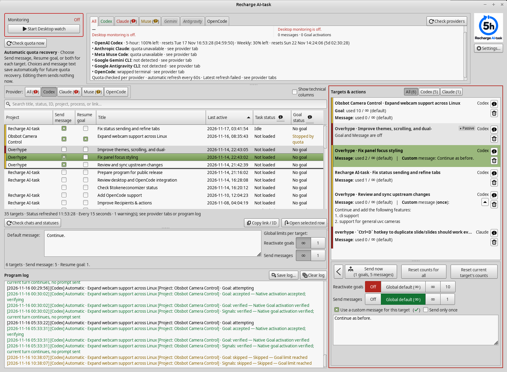
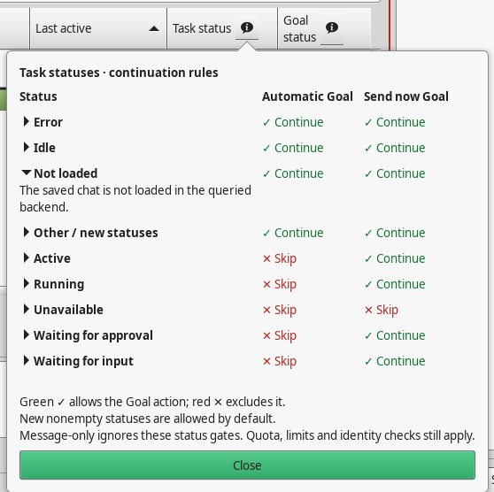

# Recharge AI-task

Continue selected AI tasks (by resuming goals and sending custom messages) after their quota usage limits are reset.

- Are you an ordinary poor peasant and a target of 5h limits of cheaper AI plans?
- Are you tired of fighting against this limit, running to your computer at specific time (even setting an alarm and purposefully waking up) just to restart a long-running task?
- Do you have resets expiring soon and you want to push the current quota limits to their limited limits?

Use **Recharge AI-task** program to automatically reset tasks according to your token quota limits.

- Do you have a specific work plan and want to send goal continuation signals and custom messages to different tasks?
- Do you want to limit how much those signals are being sent, so you have some tokens left for the rest of the week?
- Do you want to do all that across different AI providers?

**Recharge AI-task** is a user-friendly program for demanding AI users, made for both GUI mouse-clickers and for CLI automation-wizards.

-  Supported AI providers:
  1. **OpenAI Codex**,
  2. **Claude Code**
  3. **Meta (Facebook) Muse Code**
  4. **Google Gemini CLI**, **Google Antigravity CLI**
  5. **OpenCode** (a lot of different AI models, Qwen, Deepseek, etc) in wrapped interactive terminals.

- **Linux** (dashboard, a system tray, and CLI terminal commands) and **Windows** (tray, CLI).
- User-friendly. Power-user-friendly. Polished.
- Portable exec, `.deb`, `.AppImage` (incl `.zsync` delta files for updates), `.flatpak`, Windows `.exe`.



The Linux dashboard brings local chats, selected targets, recovery actions, provider quota and activity logs into one window. Each target can have its own message, signal limits and recovery plan.

## Goals vs. messages

**TLDR: Goal is sent first. Message is sent after a delay, no matter how Goal sending went.**

If only one is selected, it will be sent if it (hover mouse over the goal and message headers for more info).



If both Goal and Message type are selected, the algorithm is:

1. First the Goal continuation signal is sent.
2. It will be attempted for a few minutes.
3. After success, failure, time-out or uncertainty, the Message signal is sent.

## Download and start

Get the files from [GitHub Releases](https://github.com/mikkovedru/recharge-ai-task/releases). Python is bundled; install and sign in to the AI provider you intend to use separately.

| Platform | Download | Start |
|---|---|---|
| Linux x86_64 (Debian with glibc 2.39+ / Ubuntu 24.04 / Mint 22 family) | Linux ZIP or raw `recharge-ai-task` | Extract if needed, allow execution, then open `recharge-ai-task` |
| Debian / Ubuntu / Mint x86_64 (glibc 2.39+) | `recharge-ai-task_1.1_amd64.deb` | Install with `sudo apt install ./recharge-ai-task_1.1_amd64.deb`, then open from the app menu |
| Linux x86_64 AppImage (glibc 2.39+) | `recharge-ai-task-1.1-x86_64.AppImage`; `.AppImage.zsync` for updates | Allow execution, then open the AppImage; see [installation and updates](#appimage-installation-and-updates) |
| Linux x86_64 Flatpak (host glibc 2.39+) | `recharge-ai-task-1.1-x86_64.flatpak` | Install the standalone file, then launch from the app menu |
| Windows x86_64 | `recharge-ai-task-1.1-windows-x86_64.zip` | Extract both executables together and open `recharge-ai-task.exe` for the tray |

For a portable Linux download:

```bash
chmod +x recharge-ai-task
./recharge-ai-task
```

For the AppImage:

```bash
chmod +x recharge-ai-task-1.1-x86_64.AppImage
./recharge-ai-task-1.1-x86_64.AppImage
```

If FUSE mounting is unavailable, use `./recharge-ai-task-1.1-x86_64.AppImage --appimage-extract-and-run`. Verify the download with `sha256sum -c SHA256SUMS-appimage.txt`. The `.zsync` file is update metadata for the matching AppImage, not a program to launch. Restart Recharge after updating.

Linux has **one executable** for the dashboard, tray and terminal commands. The portable app registers a per-user menu entry and file icon when opened; keep the executable at a permanent location. You can refresh integration with `./recharge-ai-task --install-desktop`. No installer script is needed. Closing the dashboard leaves the tray running; use **Exit** in the tray to quit. `./recharge-ai-task --tray` starts without opening the dashboard.

Windows currently provides a **tray and terminal interface**, without the Linux graphical dashboard. Keep `recharge-ai-task-cli.exe` beside the tray executable for terminal actions and configuration. The ZIP includes both executables, usage/build documentation and the license. See the [Windows portable guide](docs/2026-11-17_windows-portable.md) for downloads, PowerShell commands and checksum verification. Native verification is tracked in the [release guide](RELEASE.md).

### Install the standalone Flatpak

```bash
sha256sum -c SHA256SUMS-flatpak.txt
flatpak install --user ./recharge-ai-task-1.1-x86_64.flatpak
flatpak run io.github.mikkovedru.recharge_ai_task
```

This package uses the Freedesktop 26.08 runtime and launches Recharge as your user on the host, with the same access to native providers and the desktop as the Linux executable. The download is a direct-distribution bundle. See the [Flatpak packaging and verification notes](doc/investigations/2026-11-23_flatpak-release.md) for permissions and publication status.

### Remove the Debian package

Use Cinnamon’s **Uninstall** action or Synaptic to remove the installed package. You can also run `recharge-ai-task --uninstall` to open the Recharge removal dialog with its logo and GitHub link; it opens a terminal where apt requests your password and confirmation. The launcher also includes an **Uninstall Recharge AI-task…** action. Your personal settings and logs are retained. Captain’s downloaded `.deb` window offers reinstall only; its buttons are controlled by the system installer. Captain also changes the short description to title case (rendering `AI` as `Ai`) and does not display the package logo or GitHub Homepage link. The stored description preserves `AI` correctly. The Recharge removal dialog and supporting software managers show the logo and GitHub link; opening the `.deb` in Captain does not.

After updating from an older build, launch `/usr/bin/recharge-ai-task` once. It removes the older generated per-user launcher that could hide the package-owned menu entry and prevent Cinnamon from finding the package. Customized user launchers are preserved and reported for manual review.

## Choose targets and start monitoring

1. Open your AI app and sign in. For Codex quota checks, install and sign in to [Codex CLI](https://github.com/openai/codex) with the corresponding account. Claude Code uses its subscription login. Muse Code requires a subscription and a working `muse usage --json` command (integration tested with 1.4.13).
2. Open Recharge AI-task. Select the chats to receive recovery signals and enable **Send message**, **Resume goal** (Codex only), or both in **Targets & actions**. With both enabled, Goal handling finishes first, then the message is attempted even if Goal activation fails or is unconfirmed. Each action uses its own allowance.
3. Review each target's message, grace period and signal allowances, then start monitoring. Provider filters change visibility; hidden targets retain their plans.
4. Recharge waits for exhausted quota to become usable, waits the grace period (60 seconds by default), and checks again before sending the selected actions. Monitor progress and failures in the provider status and activity log.

Local Claude Code and Muse Code sessions can be resumed by their exact session ID. An already active session is not taken over. Use a wrapped terminal for an interactive session that should keep running. Muse consumer app/browser chats are not supported targets.

## Terminal commands

Run these beside the Linux executable. On Windows replace `./recharge-ai-task` with `.\recharge-ai-task-cli.exe`.

```bash
./recharge-ai-task --version
./recharge-ai-task quota
./recharge-ai-task targets --json
./recharge-ai-task watch
./recharge-ai-task run --goal
./recharge-ai-task run --provider claude
./recharge-ai-task run --provider gemini
./recharge-ai-task run --provider antigravity
./recharge-ai-task run --provider opencode
./recharge-ai-task run --provider muse
./recharge-ai-task configure
./recharge-ai-task --help
```

Settings’ **Default terminal AI** buttons choose the provider used by the tray’s **Start [provider] terminal — auto-continue** action and by `run` or `quota` when `--provider` is omitted. A new terminal uses that provider’s saved executable and arguments. Save settings to apply the choice. Dashboard discovery and Desktop watch use all installed providers and selected targets; models and sign-in remain configured in each AI tool.

`run` wraps a provider CLI in a terminal and sends its continuation after quota recovery. Keep that terminal open. Put provider arguments after `--`, for example `./recharge-ai-task run --provider claude -- --resume SESSION_ID`. `watch` uses the saved desktop targets. Every command has `--help`.

Google: install and sign in to [Gemini CLI](https://geminicli.com/docs/get-started/authentication/) (`gemini`) or [Antigravity CLI](https://antigravity.google/docs/getting-started?tab=cli) (`agy`), then run the matching `--provider` command above. Set custom executables with `--gemini PATH` / `--antigravity PATH`, `GEMINI_CLI_PATH` / `ANTIGRAVITY_CLI_PATH`, or save their paths and interactive arguments in Settings. Each has a provider tab; OpenCode stays last. Automatic continuation requires an explicit supported reset time in a stopped usage/quota-limit banner. Native retries, model fallback and choice dialogs stay in control, and typing cancels the pending continuation. These are wrapped-terminal integrations: shared dashboard quotas, saved desktop targets, Antigravity app/IDE delivery and Codex Goal actions are unavailable. Use `/stats` in Gemini and `/usage` in Antigravity for their native usage views. See [Google integration design and limits](doc/architecture/2026-11-11_google-terminal-providers.md).

OpenCode: install and sign in to [OpenCode](https://opencode.ai/docs/cli/), then use `./recharge-ai-task run --provider opencode`. Set a custom executable with `--opencode PATH` or `OPENCODE_CLI_PATH`, or save it with `configure --provider opencode --opencode PATH`. Dashboard settings and the tray can also configure and launch OpenCode. Its provider tab explains terminal support and shows the launch command; it does not invent shared quota percentages or desktop targets. Provider filter buttons wrap when needed, and OpenCode stays last. Arguments after `--` go to its interactive CLI. Automatic continuation requires a terminal usage/rate-limit message with an explicit “try again in” duration or “try again at” time, followed by the configured grace period. Native automatic retry messages suppress extra continuation prompts, and typing during the wait cancels the pending prompt. Limits without a supported reset time remain under manual control. OpenCode uses the model provider chosen in its own configuration; shared quota checks, dashboard chat targets and Codex Goal commands are unavailable. Noninteractive `opencode run`, servers and remote attachment are outside this wrapper integration.

## Compatibility and limits

The GUI was tested on **Linux Mint 22.3 “Zena” Cinnamon**, the [latest stable Linux Mint release](https://linuxmint.com/download.php) as of 2026-11-10.

- **Linux:** release builds target compatible x86_64 Debian / Ubuntu / Mint systems with glibc 2.39 or later (Ubuntu 24.04 / Mint 22 baseline). Other distributions require testing.
- **X11 / XWayland:** window input needs `xdotool`. Prefer Codex chat-ID targets when available.
- **Wayland:** the dashboard and chat messages work without X11. Window delivery requires accessible composer and Send controls in the target app. The tray needs AppIndicator/StatusNotifier support; GNOME may need an extension.
- **Codex Resume goal:** requires Codex under X11 or XWayland, accessibility and a clipboard manager. Native Wayland Goal controls are not supported. Use **Send message** for a native Wayland Codex window.
- Desktop integrations depend on provider versions and, for Codex chat routing, private desktop interfaces. Unsupported or ambiguous targets can fail. An uncertain send is not retried automatically. Prompt acceptance does not guarantee the task completed or eliminate later permission requests.
- This tool continues work after limits recover; it does not bypass quotas. Review target messages and permissions before enabling automatic actions.

Settings and logs are local, normally under `~/.recharge-ai-task/` (Windows: `%USERPROFILE%\.recharge-ai-task\`). `RECHARGE_AI_TASK_CONFIG_DIR` selects an isolated profile. Existing settings from the original project are imported on first launch without deleting the originals.

## Limitations

1. Windows (tray, CLI) requires more testing.

2. Not all AI providers were extensively tested.

If you encounter problems, please fix and make a PR. Let's make this program complete!

## More information

- [GitHub repository and source](https://github.com/mikkovedru/recharge-ai-task)
- [Report a bug or request a feature](https://github.com/mikkovedru/recharge-ai-task/issues)

- [Target discovery, delivery and compatibility](docs/target-selection.md)
- [Provider integration design](doc/architecture/2026-11-07_unified-provider-chats.md)
- [Builds, release formats and publishing](RELEASE.md)
- [Contributing and source setup](CONTRIBUTING.md)
- [Source distribution and license](OPEN_SOURCE.md)

Based on [Autumnpoem/codex-autocontinue](https://github.com/Autumnpoem/codex-autocontinue).

Recharge AI-task adds the multi-provider dashboard, target controls, quota monitoring, tray integration and verified delivery paths maintained here.

Google/OpenCode provider tabs also show live Recharge-wrapped terminal sessions, detected reset/grace countdowns, native-retry ownership, typing cancellations and sent continuation counts. These are process-scoped observations, not account-wide quota measurements; unwrapped terminals and direct IDE chat delivery are outside this view.

## AppImage installation and updates

AppImage format is really cool. Download an application, make it executable, and run! No need to install. No system libraries or system preferences are altered. No need to fight dependencies, everything needed is in one nifty file, running on all common Linux distributions.

- [Gear Lever](https://gearlever.mijorus.it/docs/overview/) is recommended for graphical installation, menu integration and update management;
- [AM/AppMan](https://github.com/ivan-hc/AM) is the CLI alternative.
- Alternatively you can use:
  - [AppImageLauncher](https://github.com/TheAssassin/AppImageLauncher) to integrate AppImages your application launcher with one click, and manage, update and remove them from there.
  - [AppImageUpdate](https://github.com/AppImageCommunity/AppImageUpdate) to update your AppImages in a decentral way using information embedded in the AppImage itself; no central repository is involved. A Rust implementation can be found [here](https://github.com/pkgforge-dev/AppImageUpdate).

The AppImage build includes `gh-releases-zsync` update information and a matching `.AppImage.zsync` delta control file.

See the [AppImage release and update requirements](doc/requirements/2026-11-17_appimage-release.md) for build commands, the Linux baseline, manager setup and the paired-publication process. Online updates require the matching assets in a public GitHub release.
